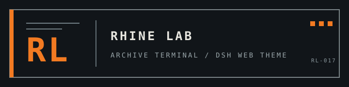

<div align="center">
  
</div>

<h1 align="center">莱茵生命主题｜将 DeepSeek Harness 重组为研究档案终端</h1>

<p align="center"><a href="README.en.md">English</a> · 简体中文</p>

<p align="center">
  
  
  
  
</p>
<p align="center">
  
  
  
  
</p>

这是一个面向 [DeepSeek Harness](https://github.com/deepseek-ai/deepseek-harness) Web 界面的《明日方舟》莱茵生命主题插件。它把对话工作区呈现为研究档案终端，同时保留 Harness 原有的控件、布局和设置流程。

- 以暖纸、浓墨和研究橙构成浅色总部档案模式。
- 以炭黑和青色实时状态构成深色夜间行动模式。
- 在 **设置 → 通用** 中用原生开关启用或关闭主题。
- 尊重减少动态效果偏好，并在窄屏隐藏非必要装饰。

## 🔥 快速开始

**环境要求：** 已安装 DeepSeek Harness，并使用 Web profile。以下命令从 GitHub 获取当前默认分支版本：

```sh
dsh plugin --profile web add github:ReLuckyLucy/dsh-Rhine-Lab-theme
```

安装后重启 `dsh web` 并刷新浏览器，再到 **设置 → 通用** 启用莱茵生命主题。要从源码运行或开发：

```sh
git clone https://github.com/ReLuckyLucy/dsh-Rhine-Lab-theme.git
cd dsh-Rhine-Lab-theme
pnpm install
pnpm build
dsh plugin --profile web add .
```

Git 安装直接使用仓库内已提交的 `lib/` 产物，不要求目标 profile 放行安装脚本；生成 npm tarball 时，`prepack` 会先重建产物。

## 📜 输入与依赖

本主题不读取用户数据集，也不需要下载模型或外部图片。它通过 DeepSeek Harness 提供的 Web 插件接口和主题令牌工作，源码中的 CSS 只作用于 Harness 页面锚点。主题偏好保存在 `ui-theme-rhine-lab.enabled`；浅色、深色或跟随系统的底色仍由 Harness 控制。

兼容性目标为 **DeepSeek Harness 0.1.0-rc.5 Web**。遇到未提供的页面锚点时，对应装饰会自然不生效，宿主控件和布局仍由 Harness 管理。

## 🔛 构建、测试与打包

```sh
pnpm install
pnpm test
pnpm build
npm pack --dry-run
```

生成可安装 tarball：

```sh
pnpm pack
dsh plugin --profile web add ./dsh-theme-rhine-lab-0.2.1.tgz
```

制作版本化源码 ZIP（需先提交包含 `VERSION` 的提交）：

```sh
python scripts/package_source.py
```

ZIP 会写入 `artifacts/`，只包含该 Git 提交中已跟踪的文件。每次推送的源码 ZIP 也会作为 GitHub Actions Artifact 保留 30 天；推送与 `VERSION` 一致的 `v` 标签后，ZIP 会附加到 GitHub Release。

## 🪦 实际界面

以下截图来自本项目真实运行的主题界面：

<p align="center"></p>
<p align="center"></p>

## 📁 项目结构

```text
dsh-Rhine-Lab-theme/
├── .github/workflows/archive.yml  # 推送归档与版本 Release
├── img/                           # README 标识
├── lib/                           # 已提交的运行构建产物
├── scripts/package_source.py      # 按 Git 提交制作源码 ZIP
├── screenshots/                  # 真实主题截图
├── src/                           # 插件源码
├── tests/                         # 主题与归档规则测试
├── VERSION                        # 源码归档版本
├── README.md                      # 中文项目主页
└── package.json                   # 插件包元数据（当前 0.2.1）
```

## 📦 版本归档

归档版本号以 [`VERSION`](VERSION) 为准，并与 `package.json` 对齐。推送提交会生成 `dsh-Rhine-Lab-theme-v版本号-提交短号.zip`。推送匹配的 `v版本号` 标签时，GitHub Actions 会创建长期 Release 并附上同一源码 ZIP。归档不包含未提交文件、`node_modules` 或运行环境。

## 📄 许可证

代码采用 [MIT License](LICENSE)。本项目是非官方粉丝主题；《明日方舟》及莱茵生命相关名称和标识归鹰角网络 / Yostar 及其权利方所有。本项目不代表或隶属于权利方。
